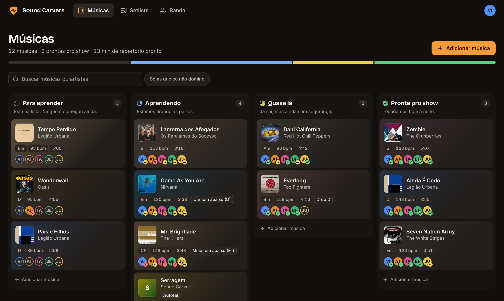
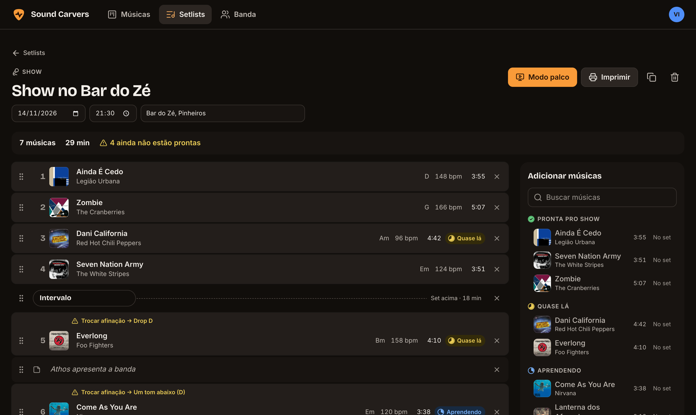
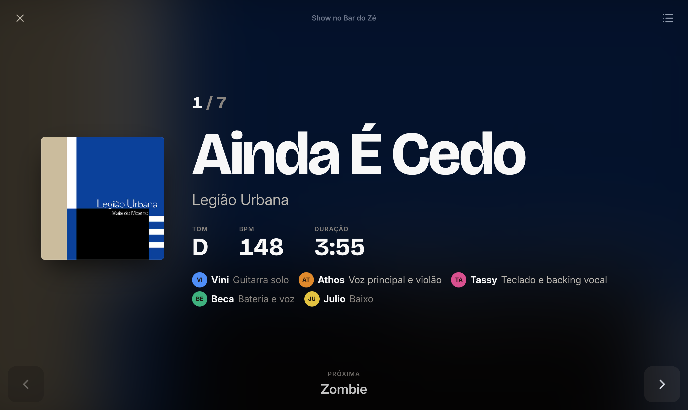
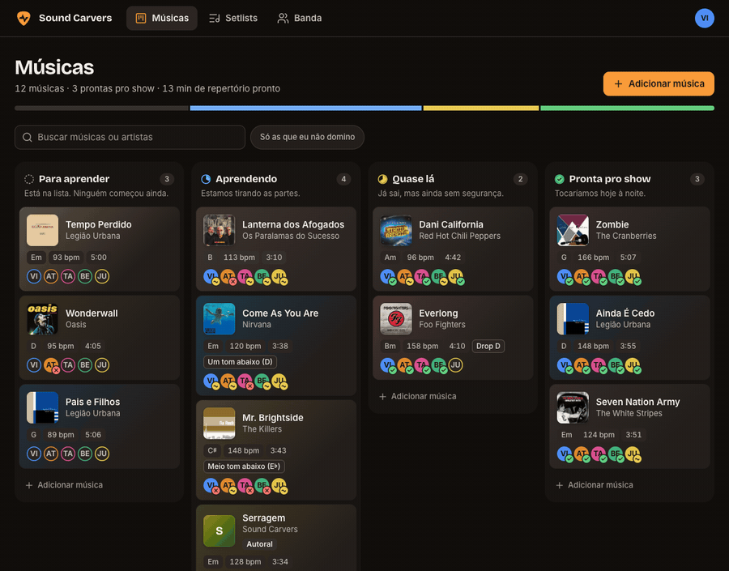

# Sound Carvers setlist

The band's shared notebook (UI in Brazilian Portuguese): every song we play or want to play, how ready we are on each one, and the setlists for shows and rehearsals.

Live at **https://soundcarvers.viniciusbregoli.dev** (shared band password, then pick who you are).

## Screenshots

Taken from a local copy with the demo data in [`video/capture/demo-data`](video/capture/demo-data).



| Setlist | Stage mode |
|---|---|
|  |  |

Dragging a song from *Aprendendo* to *Quase lá*:



## What it does

- **Song search with album art.** Typing a song in quick-add or *Adicionar música* suggests matches from Deezer (iTunes as a fallback); picking one stores the cover locally and fills in length and, when Deezer knows it, BPM. Every new song (typed or picked) is then looked up in the background to fill **only empty fields**: key (Spotify's audio analysis via ReccoBeats, matched by the Deezer ISRC), tuning (most-viewed guitar tab on Songsterr), tempo, and links to Spotify, Cifra Club, Songsterr and a YouTube search. *Completar capas, tom e links* does the same for older songs; the song sheet has a per-song button and lets you pick a different cover. Cards are tinted with the cover's color; songs without art get a generated tile.
- **Songs board.** A kanban with four stages: *To learn → Learning → Shaky → Stage-ready*. Drag cards between columns (mouse, touch with a short press, or keyboard: focus a card, <kbd>Space</kbd> to lift, arrows to move, <kbd>Space</kbd> to drop; <kbd>Enter</kbd> opens it). Quick-add per column accepts `Title - Artist`.
- **Quem faz o quê.** Each member's part on each song ("Guitarra solo", "Voz e piano"), hinted with their usual instrument and shown in Stage mode.
- **Per-member confidence.** The column is the band's verdict; each member also rates their own part (*Lost / Shaky / Solid*). Cards show everyone's rating, and "Only songs I'm not solid on" filters the board to your homework. When every member rates a song *Solid* (*Domino*), it moves to the top of *Stage-ready* on its own.
- **Song details.** Key, tempo, length, tuning, notes, and links (YouTube, Spotify, tabs, Cifra Club…). Edits autosave.
- **Song tabs.** Each song sheet has tabs: *Geral* (everything above), *Letra* (lyrics; `[Refrão]`-style section labels and chord-only lines are highlighted; covers can pull lyrics from [LRCLIB](https://lrclib.net)), *Cifra* (chord sheet, fixed-width; covers can pull the most-voted chords version from [Ultimate Guitar](https://www.ultimate-guitar.com), or paste a sheet copied from Cifra Club, which gets tidied up and fills an empty key from its "Tom:"), *Tab* (tablature), *Áudios* (rehearsal takes, demos: up to 60 MB each, playable in the page) and *Imagens* (photos of charts; big phone photos are shrunk to 2400 px before upload). Sheets autosave and update live on everyone's screen.
- **Chord diagrams.** Above lyrics and chord sheets, every chord the sheet uses is drawn for *Violão* (fingerings from [chords-db](https://github.com/tombatossals/chords-db), tap a diagram to see other positions; shapes that would play wrong notes are hidden) or *Piano* (keys worked out from the chord, slash-chord bass in blue). It reads Brazilian cifra notation: `7M`, `m7(b5)`, `A9` = add9, `4` and `7/4` = sus.
- **Setlists.** Shows and rehearsals with date, time and venue. Drag to reorder, add set breaks and notes, see total and per-set runtime, how many songs aren't stage-ready, and where you'll need to **retune** between songs.
- **Rehearsal planning.** A new rehearsal can start with the songs that need the most work (in progress, or ready but someone isn't solid), least recently rehearsed first. Tick songs off as you play them; that updates "last rehearsed".
- **Stage mode.** Full-screen, high-contrast, one song at a time with what's next, retune warnings and notes. Swipe, tap, arrow keys or a Bluetooth page-turner pedal (PageUp/PageDown). Keeps the screen awake.
- **Print.** A big-type paper setlist for the stage floor.
- **Live sync.** Everyone's changes appear instantly on every open device.

## Stack

Node 26 (runs TypeScript directly) + Hono + built-in `node:sqlite` on the server; React 19 + Vite + dnd-kit on the client. Plain CSS with oklch design tokens (`web/src/styles/tokens.css`), Inter + Bricolage Grotesque, light and dark themes.

## Develop

```sh
npm install
BAND_PASSWORD=devpassword SECURE_COOKIES=false npm run dev   # API :8787 + Vite :5180
npm test        # server tests
npm run build   # typecheck + production bundle in dist/
```

GitHub Actions ([`.github/workflows/ci.yml`](.github/workflows/ci.yml)) runs the typecheck, build and tests on Node 26, and builds the Docker image, for every pull request and every push to `main`.

## Tutorial video

[`video/`](video/) is a ~1:24 pt-BR walkthrough of the app for the band, made with [Remotion](https://www.remotion.dev).
The rendered file is [`video/out/sound-carvers-tutorial.mp4`](video/out/sound-carvers-tutorial.mp4); see
[`video/README.md`](video/README.md) to preview, edit or re-render it, or to re-capture the screenshots.

## Deployment (bregoli)

| Piece | Where |
|---|---|
| Container | `soundcarvers` in `~/services/compose.yaml`, built from this directory, `127.0.0.1:8099` |
| Data | `~/services/soundcarvers/data/setlist.db` (SQLite, WAL), `data/covers/` (downloaded album art) and `data/files/` (uploaded audio and images) |
| Password | `SOUNDCARVERS_BAND_PASSWORD` in `~/services/.env` (mode 600) |
| Public HTTPS | `soundcarvers.viniciusbregoli.dev` block in `~/services/public-proxy/Caddyfile` |
| DNS | Cloudflare CNAME `soundcarvers` → `jellyfin.viniciusbregoli.dev` (DNS-only, follows the DDNS record) |

Redeploy after changes:

```sh
cd ~/services && sudo docker compose up -d --build soundcarvers
```

Change the band password: edit `SOUNDCARVERS_BAND_PASSWORD` in `~/services/.env`, then `sudo docker compose up -d soundcarvers`. Existing sessions stay logged in; to force everyone out too:

```sh
sudo docker exec soundcarvers node -e "new (require('node:sqlite').DatabaseSync)('/data/setlist.db').exec('DELETE FROM sessions')"
```

### Backups and restore

The app writes a consistent snapshot every 6 hours to `data/snapshots/setlist-YYYY-MM-DD.db` (last 7 days kept). The whole data directory is covered by the nightly config tarball and the offsite restic backup.

To restore: `sudo docker compose stop soundcarvers`, copy a snapshot over `data/setlist.db`, delete `setlist.db-wal` and `setlist.db-shm`, then start it again.

### Security

- One shared band password (constant-time compare, 8 failed tries per IP per 15 minutes), then a 180-day `HttpOnly`, `Secure`, `SameSite=Lax` session cookie stored hashed.
- Mutations must be same-origin JSON (Origin check + content type), so other sites can't post on your behalf.
- The server only fetches artwork from Deezer/Apple CDNs (allowlisted hosts, no redirects, 2 MB cap) and proxies suggestion images, so the page never loads third-party content.
- Chord lookups only read Ultimate Guitar's search page and `tabs.ultimate-guitar.com/tab/…` sheet pages (no redirects), and only ever fill an empty Cifra tab.
- Strict CSP (no inline scripts), `X-Frame-Options: DENY`, `noindex`. User links only allow `http(s)`.
